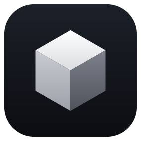

  

<h1 align="center">Skineva Launcher</h1>

  A free Minecraft: Java Edition launcher for Windows. 
  Install the game, manage mod builds and fix what breaks, all in one place.

  <a href="https://skineva.xyz/download"><strong>Download</strong></a> ·
  <a href="https://skineva.xyz/features">Features</a> ·
  <a href="https://skineva.xyz/guide">Guide</a> ·
  <a href="https://skineva.xyz/faq">FAQ</a> ·
  <a href="https://skineva.xyz/support">Support</a> ·
  <a href="#русский">Русский</a>

---

## About this repository

This repository holds the description, releases and issue tracker of Skineva Launcher. The launcher is closed source, so its code is not published here.

## Features

**Game and builds**
- Vanilla, Fabric, Quilt, Forge and NeoForge, with the right Java picked and downloaded automatically
- Separate builds with their own mods, worlds and settings
- Import and export of builds, including Modrinth `.mrpack` packs
- Downloads checked by SHA-1, with resume and retries

**Mods**
- Search and install mods, resource packs and shaders from Modrinth, with required dependencies
- Ready-made kits when creating a build: Survival, PvP, Graphics and Low-end PC
- Bulk update with a compatibility check; old versions are kept so they can be restored

**When something goes wrong**
- **Crash analysis:** explains the cause in plain words, names the likely mod and offers a one-click fix
- **Repair build:** replaces incompatible mod versions, removes duplicates, installs missing dependencies and verifies game files
- **Move to another version:** creates a copy of a build for another Minecraft version or loader and leaves the original untouched

**Performance**
- **FPS Boost:** optimization mods picked for your version, plus memory, JVM and graphics settings for your PC
- Choice of graphics card (automatic, discrete or integrated), globally or per build

**Together with friends**
- Share a build with a short code; your friend gets the same mod versions from their original sources
- Friends list with online status and one-click joining of public servers (requires Skineva ID)
- Discord status while you play

**Skins**
- Local wardrobe and 3D preview
- Cloud wardrobe with [Skineva ID](https://skineva.xyz), synced between the website and the launcher
- Skins shown in game through CustomSkinLoader, in builds with a mod loader

## Download

Get the latest version from [skineva.xyz/download](https://skineva.xyz/download) or from [Releases](../../releases/latest). The launcher then updates itself, and each update is checked against its own signature before it installs.

**Requirements:** Windows 10 or 11, 64-bit, and a licensed copy of Minecraft: Java Edition.

> **Windows SmartScreen** may warn about an unknown publisher, because the installer does not have an Authenticode certificate yet. Download it only from the links above.

## Accounts

| Account | What it is for |
|---|---|
| **Skineva ID** | Cloud wardrobe, friends and sharing builds. You sign in with a code on the website, so your password is never entered in the launcher. The game runs in offline mode, so servers that check licenses will not let you in. |
| **Local profile** | Singleplayer and servers with `online-mode=false`. |
| **Microsoft** | Sign-in with a licensed account is not available in current releases yet, as it is waiting for approval from Mojang. |

Skineva does not bypass license checks and does not let anyone pose as the owner of a licensed account.

## Mod sources

Mods come from [Modrinth](https://modrinth.com). CurseForge support is built but not enabled: it depends on API approval from CurseForge. If it is approved, files will only be downloaded from the official CurseForge CDN, and authors who do not allow third-party distribution will be respected.

## Your data

- Launcher data is stored in `%APPDATA%\com.skineva.launcher`. Sign-in tokens are encrypted with Windows DPAPI.
- Online status is visible only to accepted friends and can be turned off, together with the server you are on. Local addresses are never shared.
- See the [privacy policy](https://skineva.xyz/privacy) and [terms](https://skineva.xyz/terms) for the website and Skineva ID.

## Reporting a problem

Open an [issue](../../issues) or use the [support page](https://skineva.xyz/support). Please include:
- your launcher version and Windows version;
- the Minecraft version and mod loader of the build;
- the logs: Settings → Advanced → Export logs.

Before sharing logs or screenshots, check that they do not contain anything private.

---

## Русский

**Skineva Launcher** — бесплатный лаунчер Minecraft: Java Edition для Windows: установка игры, сборки с модами и исправление того, что сломалось.

Здесь находятся описание, выпуски и список проблем. Код лаунчера закрыт и в этом репозитории не публикуется.

### Возможности

- **Игра:** Vanilla, Fabric, Quilt, Forge и NeoForge; подходящая Java подбирается и скачивается автоматически.
- **Моды:** поиск и установка модов, ресурспаков и шейдеров с Modrinth вместе с зависимостями; готовые наборы «Выживание», «PvP», «Графика» и «Слабый ПК»; обновление всех модов с проверкой совместимости.
- **Разбор вылетов:** причина простыми словами, вероятный мод и исправление одной кнопкой.
- **Починка сборки:** замена несовместимых версий, удаление дубликатов, установка недостающих зависимостей и проверка файлов игры.
- **Перенос:** копия сборки на другой версии Minecraft или загрузчике, исходная сборка не меняется.
- **Буст ФПС:** моды оптимизации под вашу версию, настройки памяти, JVM и графики под ваш ПК, выбор видеокарты.
- **Вместе с друзьями:** обмен сборками по короткому коду, список друзей со статусом онлайн и подключение к публичному серверу друга (нужен Skineva ID), статус в Discord.
- **Скины:** локальный и облачный гардероб, 3D-просмотр, скины в игре через CustomSkinLoader в сборках с загрузчиком модов.

### Скачать

Последняя версия: [skineva.xyz/download](https://skineva.xyz/download) или [Releases](../../releases/latest). Дальше лаунчер обновляется сам и проверяет подпись каждого обновления.

**Нужно:** Windows 10 или 11 (64-бит) и лицензионная Minecraft: Java Edition.

Windows SmartScreen может предупредить о неизвестном издателе: у установщика пока нет сертификата Authenticode. Скачивайте его только по ссылкам выше.

### Аккаунты

- **Skineva ID:** облачный гардероб, друзья и обмен сборками. Вход по коду на сайте, пароль в лаунчер не вводится. Игра запускается в офлайн-режиме, поэтому серверы с проверкой лицензии не пустят.
- **Локальный профиль:** одиночная игра и серверы с `online-mode=false`.
- **Microsoft:** вход с лицензионным аккаунтом в текущих версиях пока недоступен: ждём одобрения Mojang.

Skineva не обходит проверку лицензий и не позволяет выдавать себя за владельца лицензионного аккаунта.

### Если что-то не работает

Создайте [issue](../../issues) или напишите через [страницу поддержки](https://skineva.xyz/support). Укажите версию лаунчера и Windows, версию Minecraft и загрузчик сборки, приложите журналы: Настройки → Дополнительно → «Экспорт журналов». Перед отправкой проверьте, что в журналах и на скриншотах нет личных данных.

---

Skineva is not affiliated with or endorsed by Mojang, Microsoft, Modrinth, CurseForge or Discord. Minecraft is a trademark of Mojang Synergies AB.
